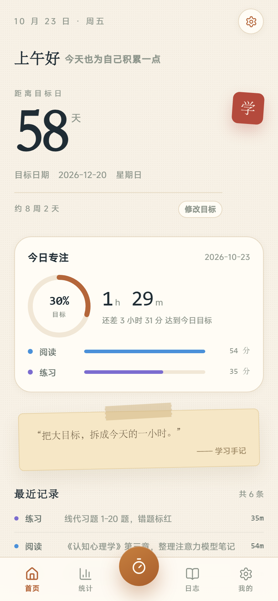
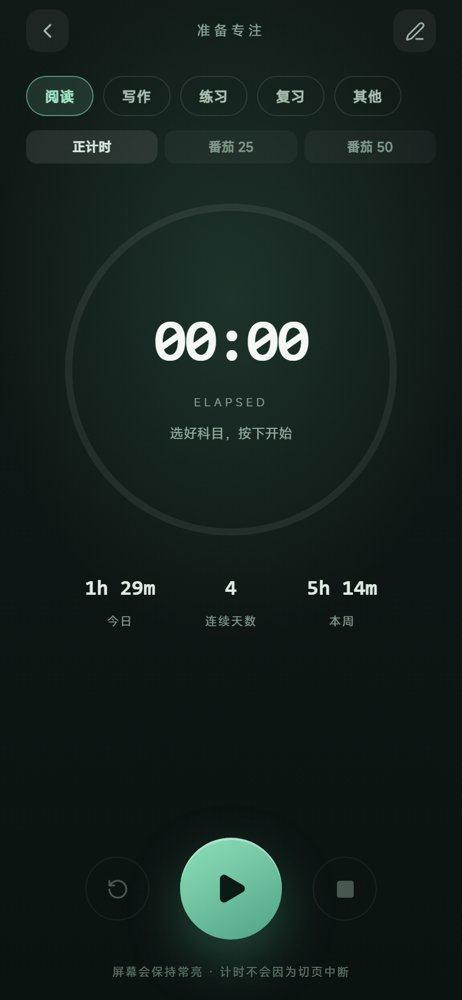
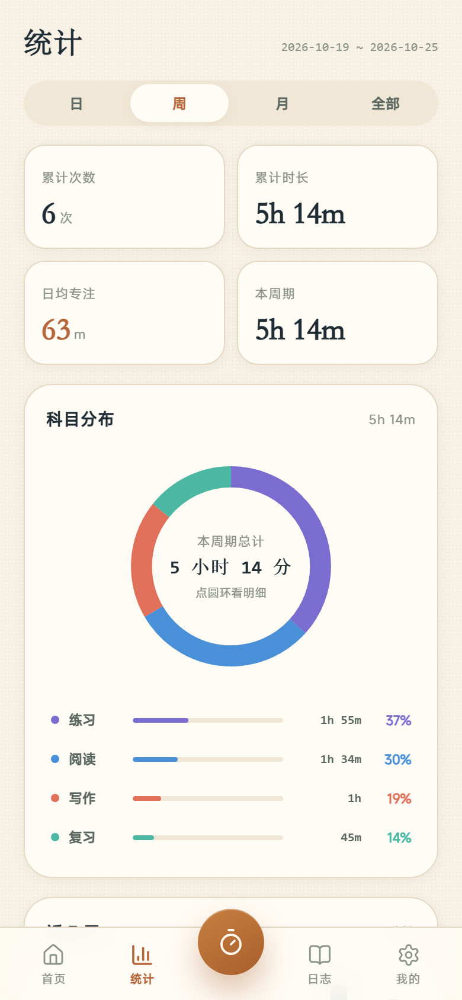
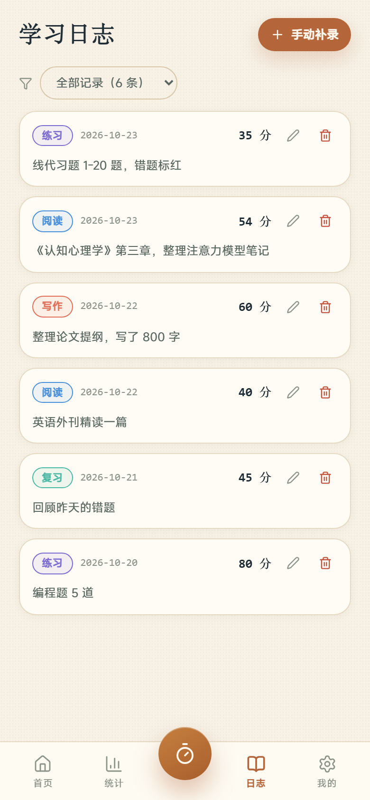
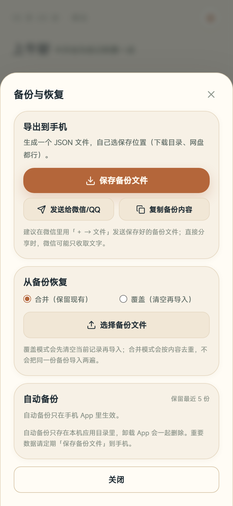

# 学时记（工作名）

> 安静的学习记录工具 · 纯本地 · 不联网 · 无账号 · 无广告

从「考研倒计时」升级为**通用学习记录**：目标日、专注计时、科目统计、学习日志与复盘，数据全部留在你自己的手机上。

> 名称目前是工作名，最终名称待定。改名只需修改 `app/src/brand.js` 一处。

## 截图

| 首页 | 计时 |
|---|---|
|  |  |

| 统计 | 日志 |
|---|---|
|  |  |

| 备份与恢复 |
|---|
|  |

## 功能

- **目标日**：可选倒计时，支持设定 / 修改 / 清除，不再绑定考试
- **专注计时**：秒表与番茄钟（25/50），科目切换、暂停/继续、结束保存
- **直接录入**：忘记计时也能按日期 + 时长补记
- **今日概览**：当天总时长、目标进度、各科目占比、最近记录
- **统计**：日 / 周 / 月 / 全部，累计次数与时长、日均、科目分布、近 7 天趋势、打卡热历
- **日志**：按日期倒序、科目标签、行内编辑/删除、按日期筛选、每日复盘
- **备份**：系统「保存到文件」导出真文件、文件导入（合并/覆盖）、自动备份 5 份 + 一键恢复
- **纯本地**：无联网请求，无账号，卸载即清空（请定期导出备份）

## 下载安装

- **Gitee Releases**：<https://gitee.com/zhang-rui_zhe/yanshiji/releases>
- **GitHub Releases**：<https://github.com/Zuozhu-ui/yanshiji/releases>

首次安装需允许「安装未知来源应用」。**升级时请直接覆盖安装，不要先卸载**，否则本地数据会一起删除。

## 技术栈

| 层 | 选型 |
|---|---|
| 前端 | React 19 + Vite 8（无路由库、无状态库，服务层单例 + props） |
| 原生壳 | Capacitor 8（Android） |
| 存储 | 浏览器 localStorage（字段与 key 兼容旧版本） |
| 原生插件 | `BackupFilePlugin`（SAF 文件保存/选择） |
| 打包 | Android release APK，正式签名（密钥不入库） |
| 分发 | Gitee / GitHub Releases，`backend/` 提供可选的零依赖分发服务 |

## 目录结构

```
.
├── app/                      # React + Capacitor 前端
│   ├── src/
│   │   ├── brand.js          # 品牌名 / 备份标识（改名只改这里）
│   │   ├── pages/            # 首页、计时、统计、日志
│   │   ├── components/       # 卡片、图表、弹窗
│   │   ├── services/         # 存储、计时状态机、自动备份、SAF 封装
│   │   └── styles/tokens.css # 设计令牌
│   ├── android/              # Capacitor 原生工程（含自定义插件）
│   ├── test_suite.mjs        # 纯函数单元测试（13 项）
│   └── dist-capacitor/       # 构建产物（不入库）
├── backend/                  # 可选：APK 分发服务（Node，零依赖）
├── docs/                     # 开发文档与路线图
├── screenshots/              # 界面截图
└── 研时记-开发文档-完善版.md  # v1.1 旧方案（Flutter），仅作历史参考
```

## 本地开发

```bash
cd app
npm install
npm run dev          # http://localhost:5173
npm test             # 纯函数测试（node test_suite.mjs）
npm run lint         # oxlint
```

### 打包 APK

> 必须使用 **JDK 21**（Capacitor 8 插件要求），Android SDK 36。

```bash
cd app
npm run build -- --base=/ --outDir=dist-capacitor   # 原生用的 Web 资源
npx cap sync android
cd android && ./gradlew assembleRelease
# 产物：app/android/app/build/outputs/apk/release/app-release.apk
```

签名配置在 `app/android/keystore.properties`（本地文件，已 gitignore）。`versionCode` 每次发版必须递增。

## 数据与兼容

升级不丢数据的前提（已固定，**不要改**）：

1. `applicationId` = `com.yanshiji.app`
2. 同一签名密钥
3. `versionCode` 递增
4. `androidScheme` 保持 `https`（WebView 存储按 origin 隔离）

内部存储 key（`yanshiji_*`）与字段名保持不变；备份文件的应用标识已改为新名字，但导入同时接受旧版「研时记」的备份。

## 文档

- [开发文档](docs/开发文档.md)：架构、数据模型、业务规则、原生插件、构建发布
- [路线图](docs/ROADMAP.md)：v1.3 / v1.4 规划与验收标准
- [更新日志](CHANGELOG.md)
- [后端分发服务](backend/README.md)

## 许可

见 [LICENSE](LICENSE)。
