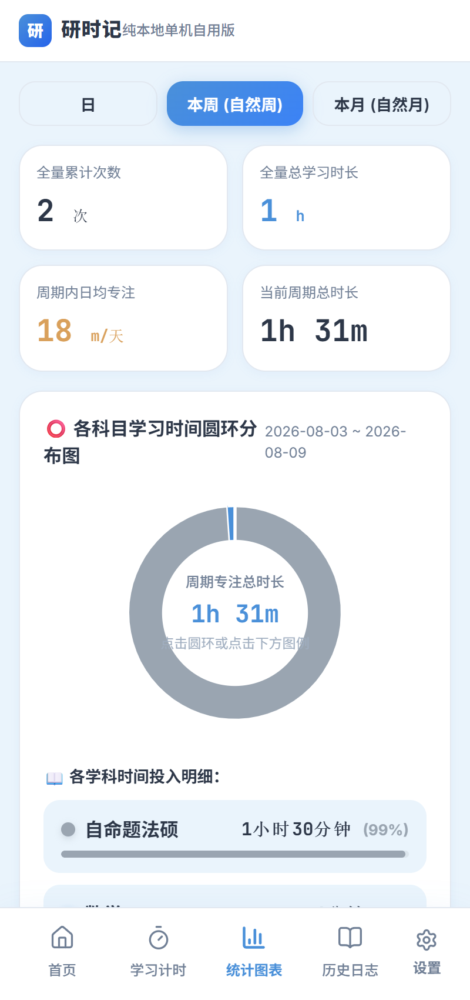
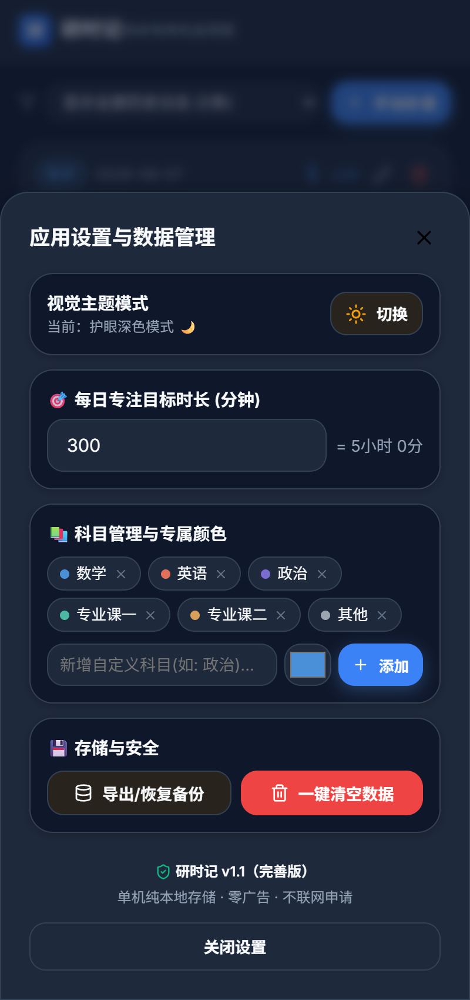

# 研时记

> **免费**的考研学习计时统计 App · 纯本地单机 · 无需联网 · 无账号 · 无广告

面向考研备考人群的单机学习计时统计软件：自定义目标考试日期倒计时、学习计时打卡、各学科时间占比统计、历史日志管理。**全部数据存在设备本地**，离线可用，卸载即失、可随时备份导出。

## 功能特性

- 🗓️ 自定义目标考试日期倒计时（到期自动切换"已考完"）
- ⏱️ 学习计时：科目选择、开始 / 暂停 / 结束、本次学习内容记录
- 📊 统计图表：日 / 周 / 月维度、学科时长饼图占比、累计 / 日均时长
- 📜 历史日志：按日期倒序、编辑 / 删除、指定日期筛选
- 📝 手动补录（忘记计时也能补记）
- 💾 JSON 备份导出 / 导入
- 🔒 纯本地存储：无联网、无账号、无广告、无任何隐私收集

## 截图

| | | |
|---|---|---|
|  |  |  |
|  |  | |

## 下载安装

- **APK 安装包**：见页面右侧 **Release 发行版**（Android，装好后完全独立运行，无需电脑/网络）
- Android 首次安装需开启「允许未知来源应用」，详见各品牌设置
- 也支持直接以 **Web 在线版** 使用（见 backend 分发服务）

## 技术栈

- 前端：React (Vite) + Capacitor，数据存浏览器 localStorage
- 打包：Android release APK，正式签名（密钥不入库）
- 分发：`backend/` 零依赖 Node 服务（APK 下载 + Web 托管）

## 仓库结构

```
研时记/
├── 研时记-开发文档-完善版.md   # 开发依据文档（含技术选型/统计口径/边界用例）
├── app/                        # 前端源码（React + Vite + Capacitor）
│   ├── src/                    #   React 源码
│   ├── dist/                   #   Web 在线版构建（base=/public/web/，供 backend 分发）
│   ├── dist-capacitor/         #   原生 App 用的 Web 资源（base=/）
│   ├── android/                #   Capacitor 生成的 Android 原生工程
│   └── capacitor.config.json   #   Capacitor 配置
└── backend/                    # 安装包分发服务（Node，零依赖）
    ├── server.js               # 分发服务入口（下载页 + Web 在线版 + APK）
    ├── publish.js              # 发布脚本（登记新版本 APK）
    ├── public/index.html       # 移动端下载页
    └── data/                   # versions.json + APK 存放目录
```

## 分工约定

| 模块 | 负责方 | 说明 |
|---|---|---|
| 移动端 App（React + Capacitor） | 前端团队 | 界面 + 业务逻辑，纯本地存储（浏览器 localStorage），**不调用后端接口** |
| 安装包分发服务（后端） | 本仓库 `backend/` | 负责 APK 下载分发 + Web 在线版托管 |

前端与后端的唯一交集：前端构建出的 **APK** → `node backend/publish.js` 登记 → 用户下载页即可见（无需重启服务）。详见 [backend/README.md](backend/README.md) 的「前端打包契约」。

## 手机安装路径（当前方案：真 APK）

```
app/ (React 源码) ──vite build──▶ dist-capacitor ──npx cap sync android──▶ android/ ──gradlew assembleRelease──▶ app-release.apk
                                                                                                            │
                            user 手机 ◀──下载安装── backend/data/apk ◀──node publish.js──┘
```

APK 重新构建流程：见 [backend/README.md](backend/README.md) 第四节。

## 快速上手

```bash
# 分发服务（本地/局域网测试）
cd backend
node server.js
```

正式分发需 HTTPS 域名，部署说明见 [backend/README.md](backend/README.md)。
